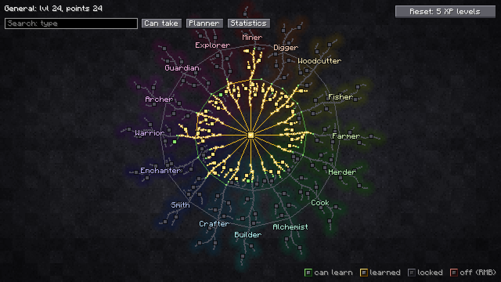
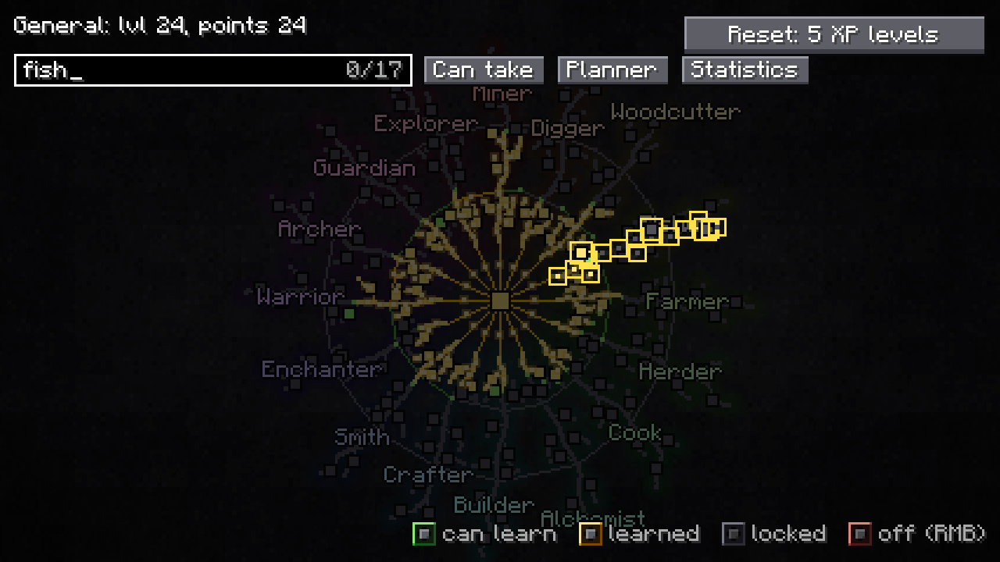
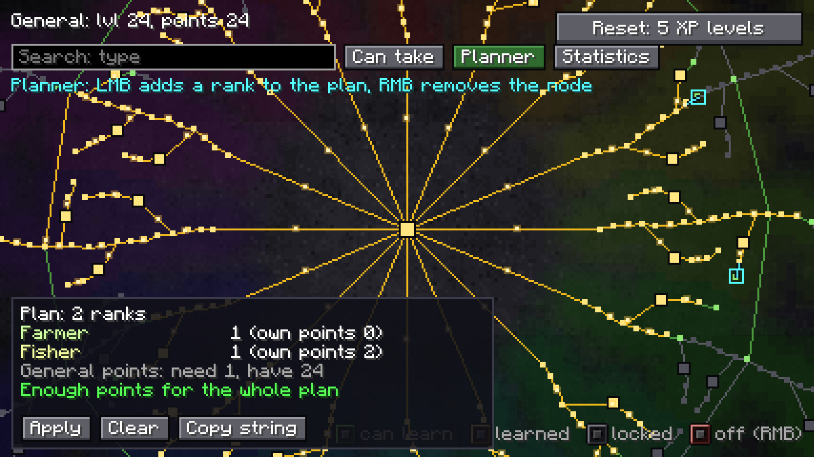
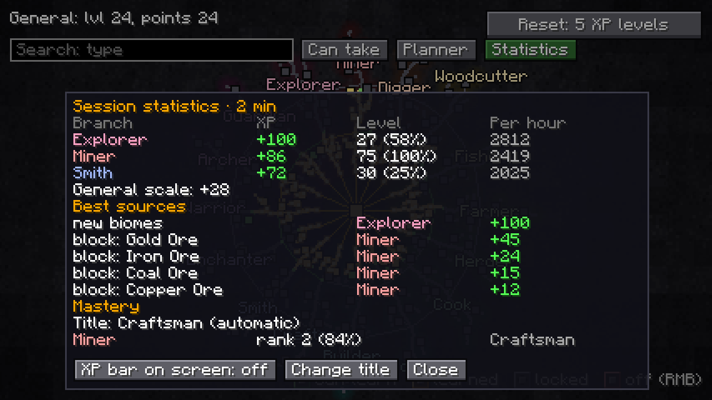
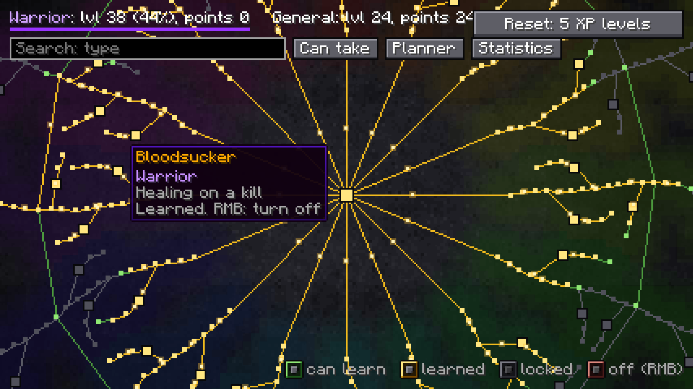

<div align="center">

[Русский](README.md) · **English**

# Path-of-craft-tree

**A huge passive skill tree for Minecraft on [Horizon](https://github.com/horizon-rust/horizon).**<br>
Mine, chop, cook, fight: every activity levels its own profession, and levels pay points into a 1200-node tree.

[](https://github.com/Betreazen/path-of-craft-tree/releases/latest)


[](LICENSE)

[Install](#install) · [Profession reference](https://betreazen.github.io/path-of-craft-tree/showcase/) · [For servers](#for-server-owners) · [Changelog](CHANGELOG.md)



</div>

## What it is

You earn profession experience for what you actually do: a pickaxe levels the Miner, a rod the Fisher, a bow the Archer. Each level makes you a little better at that work and pays a point to spend in the profession's branch of the tree. Part of all experience also feeds a general scale whose points can be spent in any branch, say to lift one that lags behind.

- **16 professions in 4 sectors**, 75 levels each. About 50 hours of keen play per branch.
- **1200 nodes**: small bonuses, big abilities and their boosters. A branch costs 79–85 points and its 75 levels pay 75, so you can't take everything and have to choose.
- **285 effects**, each checked in game: area digging, whole-tree felling, vein mining, auto-smelting, a pocket crafting table, homecoming, ore sense and many more.
- **Mastery past level 75**: ten slow ranks and a title, from "Connoisseur" up to each branch's own, such as the Miner's "Lord of the Deep".
- **Search, planner and statistics** right in the tree window. Share a build as a string.
- **Honest experience.** A block you placed pays nothing when you break it, and pistons don't get around that. Spawner mobs pay a quarter. The anvil, brewing and building are guarded against farms. Creative mode and commands pay nothing.
- **Play together.** A group mate nearby gets a share of your experience. The server site's leaderboard shows only players who opted in.
- **Russian and English.** If the game isn't set to Russian, the tree, the window, messages and player commands are in English.
- **Works with other mods.** RustCraft machines earn their owner half the experience of the same work by hand, and SoulsCraft scales its mobs to your tree.

<table>
<tr>
<td width="50%"></td>
<td width="50%"></td>
</tr>
<tr>
<td align="center"><b>Search</b>: just type, matches light up</td>
<td align="center"><b>Planner</b>: build a path, apply it with one button</td>
</tr>
<tr>
<td width="50%"></td>
<td width="50%"></td>
</tr>
<tr>
<td align="center"><b>Statistics</b>: XP per hour, best sources, mastery</td>
<td align="center"><b>Tooltip</b>: what a node gives and how to take it</td>
</tr>
</table>

## Professions

| Sector | Professions |
| --- | --- |
| ⛏️ Gathering | **Miner** (pickaxe), **Digger** (shovel), **Woodcutter** (axe), **Fisher** |
| 🌾 Husbandry | **Farmer**, **Herder**, **Cook**, **Alchemist** |
| 🔨 Craft | **Builder**, **Crafter**, **Smith**, **Enchanter** |
| 🗺️ Roaming | **Warrior**, **Archer**, **Guardian**, **Explorer** |

Related actions feed two branches: ore that drops straight as an ingot levels the Miner and, at 80%, the Smith. Every node, effect and experience source, with a live tree to explore, is in the [profession reference](https://betreazen.github.io/path-of-craft-tree/showcase/) (in Russian). The full design, with the reasoning behind the numbers, is in [docs/design.md](docs/design.md) (in Russian).

## Controls

| What | How |
| --- | --- |
| Open the tree | **K** or `/tree` |
| Learn a node or its next rank | left mouse button |
| Turn a big node off (the point is not refunded) | right mouse button |
| Zoom, pan | mouse wheel, drag |
| Ore Sense · Cartographer · Treasure Sense | **V** · **J** · **I** |
| Homecoming · Pocket Bench · Sharpener | **H** · **Y** · **U** |
| Branch XP bar at the top of the screen | unbound by default; or the button on the Statistics page |

<details>
<summary><b>Search, planner and builds</b></summary>

| What | How |
| --- | --- |
| Search node names and descriptions | just type; matches light up, the rest dims |
| Next and previous match | **Enter** or **↓**, **Shift+Enter** or **↑** |
| Clear the search | **Esc** (a second **Esc** closes the window), **Backspace**, **Ctrl+Backspace** |
| Only nodes you can take now | the "Can take" button |
| Planner: build a path without spending points | the "Planner" button, then LMB adds a rank to the plan, RMB removes a node |
| Learn the plan | "Apply": every rank you have points for goes through, the server checks each |
| Share a build | "Copy string" or **Ctrl+C**: a `PCT1:…` string goes to the clipboard |
| Load someone's build | **Ctrl+V** in the window, or paste the string into the search and press **Enter** |
| Session XP and best sources | the "Statistics" button |

</details>

Ability keys work once the node is learned. Every key of the tree can be rebound in Options → Mods → the "Settings" button next to Path-of-craft-tree; the table shows the defaults.

## Install

You need the [Horizon launcher](https://github.com/horizon-rust/horizon) and a licensed Minecraft: Java Edition account.

> [!WARNING]
> Horizon native mods are compiled straight into the game and run with your rights, unsandboxed. Read the source before installing. The launcher asks you to confirm that you trust the mod. See [SECURITY.md](SECURITY.md).

The mod is one bundle with two halves: the client draws the tree, the server counts experience and runs the effects. So it is needed both in the game and on the server.

### Single player and LAN

**In the launcher window:** Mods → **Add from GitHub** → paste `https://github.com/Betreazen/path-of-craft-tree` → **Build**.

**From the command line:**

```powershell
horizon-launcher mods add-github https://github.com/Betreazen/path-of-craft-tree --trust-native-code
horizon-launcher native-build --trust-native-code
```

The launcher takes the [latest release](https://github.com/Betreazen/path-of-craft-tree/releases/latest). The first build downloads Rust and takes 20–30 minutes; later ones are faster. The mod builds on the Horizon commit pinned in it (`[compatibility] horizon_revision` in `mixins/path_of_craft_tree/horizon-mixin.toml`). If your other native mods pin another commit, the launcher offers **Build anyway**.

Update: `horizon-launcher mods update-github --trust-native-code`, then `native-build` again.

### Dedicated server

A dedicated server runs a separately built engine:

```powershell
git clone --branch v0.5.2 https://github.com/Betreazen/path-of-craft-tree
horizon-launcher native-build path-of-craft-tree/mixins/path_of_craft_tree `
    --server-output C:\horizon-engines\pct-0.5.2 --version <Horizon version> --trust-native-code
horizon-server --dir <server folder> config set engine.path=C:\horizon-engines\pct-0.5.2\horizon-engine.exe
horizon-server --dir <server folder> restart
```

The `--server-output` folder must not exist beforehand. To build a server with several mods, put their folders side by side and pass the parent folder to `native-build`. See [Horizon's native mod docs](https://github.com/horizon-rust/horizon/blob/main/docs/native-mods.md#standalone-server-export).

Players need the same mod version in their game; the server disconnects a client with another protocol version.

## For server owners

### Settings

Experience multipliers and group numbers change without rebuilding the mod. `config/path_of_craft_tree-server.json` sits in the server folder next to `server.properties` (in single player, in the game's `config` folder). If it's missing, the server writes one with the defaults on start. The defaults change nothing: experience follows the tree's data.

```json
{
  "xp_multiplier": 1.0,
  "branch_multipliers": { "fishing": 1.5, "building": 0.8 },
  "general_share": null,
  "group": { "share": 0.15, "radius": 32, "max_size": 4 }
}
```

| Setting | Default | Allowed | Effect |
| --- | --- | --- | --- |
| `xp_multiplier` | 1 | 0–10 | Multiplies all experience of all branches |
| `branch_multipliers` | empty | 0–10 per branch | Multiplies one branch on top of the global multiplier. Keys are branch ids: `mining`, `fishing`, `melee` and so on |
| `general_share` | `null` | `null` or 0–1 | The share of main experience that goes to the general scale. `null` keeps the tree's 0.15 |
| `group.share` | 0.15 | 0–0.5 | The share a group mate nearby receives |
| `group.radius` | 32 | 1–128 | How close, in blocks, the mate must be |
| `group.max_size` | 4 | 2–8 | Players per group |

The file is read on start and on `/pct admin reload` (`pct admin reload` in the server console); no restart needed. A mistake in it never stops the server: a bad value falls back to the default and each error is logged as `path_of_craft_tree: server settings: …`.

### Commands

| Command | Who | Effect |
| --- | --- | --- |
| `/tree` | any player | Opens the tree window |
| `/pct leaderboard on` · `off` | any player | Show your levels on the server site's leaderboard. Off by default. File format: [docs/leaderboard.md](docs/leaderboard.md) |
| `/pct group invite <player>` | any player | Invites a player to a group; the invitation lasts 2 minutes |
| `/pct group accept` · `leave` · `list` | any player | Accept, leave, show the group |
| `/pct admin give <player> <branch> <xp>` | operator level 2+, console | Adds branch experience; `general` names the general scale |
| `/pct admin take <player> <branch> <xp>` | operator level 2+, console | Removes experience, not below 0 |
| `/pct admin level <player> <branch> <level>` | operator level 2+, console | Sets a branch level |
| `/pct admin reset <player>` | operator level 2+, console | Resets the tree for free: points come back, experience stays |
| `/pct admin show <player>` | operator level 2+, console | Levels, experience and free points per branch |
| `/pct admin reload` | operator level 2+, console | Re-reads the server settings |

Name an online player by name and an offline one by UUID. Every change is logged with who did what to whom, and an online player gets a chat message.

The hourly pace log (`pace.jsonl`, players replaced by a salted hash), the data locations and the rest of the server notes are in the [Russian README](README.md#для-владельцев-серверов).

## For mod authors

- **Machine experience.** Your mod's machines can earn their owner experience through the `pct-machine` console command. Without Path-of-craft-tree it silently does nothing, so the mods don't depend on each other at build time: [docs/machine-reports.md](docs/machine-reports.md).
- **Player strength.** PCT puts a `pct:summary` on every player's shared data: levels and learned ranks of all 16 branches and the general scale. SoulsCraft scales its mobs by it.
- **Stronger mobs.** A mob another mod made stronger can carry the tag `pct.xp145`, and killing it pays 145% experience: [docs/combat-summary.md](docs/combat-summary.md).

## Development

```powershell
cargo test                                  # 258 rule tests, no game build
cargo bench --bench rules                   # criterion benchmarks on a veteran profile
cargo clippy --all-targets -- -D warnings -A dead_code
.\dev.ps1 both                              # build both halves of the mod
```

The server console command `pct_selftest run` walks 42 scenarios on a live server in a fraction of a second: machine experience, tags on real mobs, several players at once, settings, admin commands and groups ([docs/selftest.md](docs/selftest.md)). In-game numbers, performance build, veteran profile: tree window frame 0.22 ms (budget 1.5 ms), block break 20.7 µs (30 µs), player tick 13.8 µs (20 µs).

See [CONTRIBUTING.md](CONTRIBUTING.md) for how to propose a change.

## License

[MIT](LICENSE). Not affiliated with or endorsed by Mojang, Microsoft or the Horizon project. A licensed Minecraft: Java Edition is required to play.
