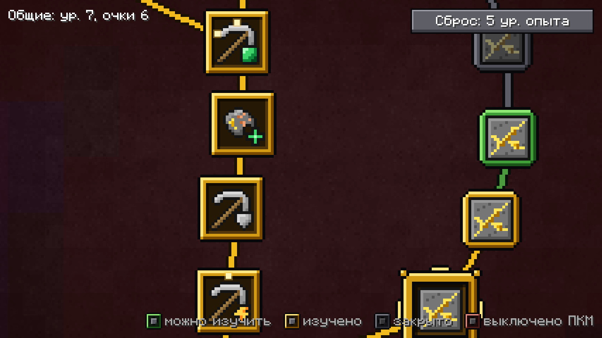
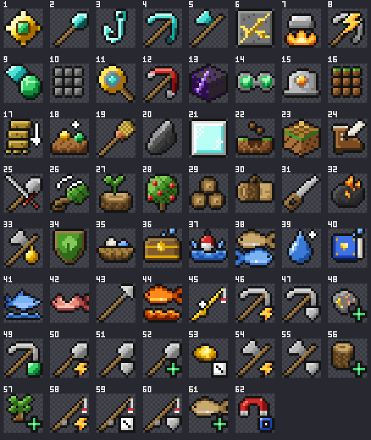

<div align="center">

# Path-of-craft-tree

**Огромное дерево пассивных умений для Minecraft на [Horizon](https://github.com/horizon-rust/horizon).**
Копайте, рубите, готовьте, сражайтесь: каждое занятие качает свою профессию, а уровни приносят очки для дерева на 1200 узлов.


</div>

## Что это

Вы получаете опыт профессии за то, чем занимаетесь: кирка качает Шахтёра, удочка Рыбака, лук Стрелка. Уровень профессии понемногу усиливает вас в этом деле и приносит очко, которое тратится в её ветви дерева. Часть опыта идёт ещё и в общую шкалу, а её очки можно потратить в любой ветви, например чтобы подтянуть отстающую.

- **16 профессий в 4 секторах**, 75 уровней у каждой.
- **1200 узлов**: малые прибавки, большие умения и их усилители. 121 узел имеет по два ранга. Ветвь стоит 79–85 очков, а её 75 уровней дают 75: всё не взять, приходится выбирать.
- **Мастерство после 75-го уровня**: опыт ветви идёт дальше, в 10 медленных рангов мастерства. Очков и силы они не дают, только титул: от «Знатока» до своего у каждой ветви, например «Владыка недр» у Шахтёра.
- **Русский и английский.** Если игра не на русском, дерево, окно, сообщения и команды игрока показываются по-английски (словарь в `data/en-*.json`).
- **285 эффектов**, каждый проверен в игре: копание площадью, падение дерева целиком, жила руды, автоплавка, карманный верстак, возвращение домой, рудный нюх и многое другое.
- **Честный опыт.** Поставленный блок не даёт опыта, когда его ломаешь. Мобы из спавнера дают четверть. В творческом режиме и за команды опыта нет.
- **Машины работают на владельца.** Механизмы других модов приносят своему владельцу половину опыта за ту же работу ([как подключить свой мод](docs/machine-reports.md)).
- **Сброс дерева** стоит 5 уровней обычного опыта Minecraft.
- **Баланс живёт в данных.** Опыт за действия, кривая уровней и все узлы лежат в `data/tree.json`.

Справочник по всем профессиям с живым деревом, которое можно покрутить и поизучать: [docs/showcase/index.html](docs/showcase/index.html). Он открывается прямо с диска. Данные для него собирает `node design/tools/showcase-data.mjs`.

<table>
<tr>
<td width="50%"></td>
<td width="50%"></td>
</tr>
<tr>
<td align="center">Подсказка: что даёт каждый ранг</td>
<td align="center">У каждого узла своя иконка 16×16</td>
</tr>
</table>

## Профессии

| Сектор | Профессии |
| --- | --- |
| ⛏️ Добыча | **Шахтёр** (кирка), **Копатель** (лопата), **Лесоруб** (топор), **Рыбак** |
| 🌾 Хозяйство | **Фермер**, **Скотовод**, **Повар**, **Алхимик** |
| 🔨 Ремесло | **Строитель**, **Крафтер**, **Кузнец**, **Чародей** |
| 🗺️ Странствия | **Воин**, **Стрелок**, **Страж**, **Исследователь** |

<p align="center"><br><sub>Иконки сектора «Добыча» в стиле ванильного Minecraft</sub></p>

Смежные действия кормят две ветви. Например, руда, которая сразу падает слитком, качает Шахтёра и на 80% Кузнеца. Подробно о каждой профессии, узлах и источниках опыта — в [дизайн-документе](docs/design.md).

## Управление

| Что | Как |
| --- | --- |
| Открыть дерево | **K** или команда `/tree` |
| Изучить узел или следующий ранг | левая кнопка мыши |
| Выключить большой узел (очко не возвращается) | правая кнопка мыши |
| Приблизить, сдвинуть | колесо мыши, перетаскивание |
| Рудный нюх · Картограф · Чутьё сокровищ | **V** · **J** · **I** |
| Возвращение домой · Карманный верстак · Точильщик | **H** · **Y** · **U** |
| Полоса опыта ветви наверху экрана | без клавиши, назначается в настройках; или кнопка на странице «Статистика» |

В окне дерева:

| Что | Как |
| --- | --- |
| Поиск по названиям и описаниям узлов | просто печатайте; найденное подсвечивается, остальное темнеет |
| Следующий и предыдущий найденный узел | **Enter** или **↓**, **Shift+Enter** или **↑** |
| Стереть поиск | **Esc** (второй **Esc** закрывает окно), **Backspace**, **Ctrl+Backspace** |
| Только узлы, которые можно взять сейчас | кнопка «Можно взять» |
| Планировщик: собрать путь без траты очков | кнопка «Планировщик», затем ЛКМ добавляет ранг в план, ПКМ убирает узел |
| Изучить план | кнопка «Применить»: уходят ранги, на которые хватает очков, сервер проверяет каждый |
| Поделиться сборкой | кнопка «Копировать строку» или **Ctrl+C**: строка вида PCT1:… попадает в буфер обмена |
| Загрузить чужую сборку | **Ctrl+V** в окне, или вставьте строку в поиск и нажмите **Enter** |
| Опыт за сессию и лучшие источники | кнопка «Статистика» |

Клавиши умений работают, когда узел изучен. Все клавиши дерева можно переназначить: «Настройки» → «Моды» → кнопка «Настройки» рядом с Path-of-craft-tree. В таблице — клавиши по умолчанию. Остальные приёмы (Линия, Заливка, Замена, Чертёж, Засыпка) описаны в [разделе 9 дизайн-документа](docs/design.md#управление).

## Установка

Нужны [лаунчер Horizon](https://github.com/horizon-rust/horizon) и лицензионный аккаунт Minecraft: Java Edition.

> [!WARNING]
> Нативные моды Horizon компилируются прямо в игру и работают с вашими правами, без песочницы. Перед установкой прочитайте код. Лаунчер попросит подтвердить, что вы доверяете моду.

Мод состоит из двух половин в одном наборе: клиент рисует дерево, сервер считает опыт и эффекты. Поэтому он нужен и в игре, и на сервере.

### Одиночная игра и игра по сети с хостом

**В окне лаунчера:** Mods → **Add from GitHub** → вставьте `https://github.com/Betreazen/path-of-craft-tree` → **Build**.

**Из командной строки:**

```powershell
horizon-launcher mods add-github https://github.com/Betreazen/path-of-craft-tree --trust-native-code
horizon-launcher native-build --trust-native-code
```

Первая сборка скачивает Rust и занимает 20–30 минут, следующие быстрее. Мод собирается на коммите Horizon, который в нём закреплён (`[compatibility] horizon_revision` в `mixins/path_of_craft_tree/horizon-mixin.toml`). Если другие ваши нативные моды закреплены на другом коммите, лаунчер предложит **Build anyway**.

Обновить мод: `horizon-launcher mods update-github --trust-native-code`, затем снова `native-build`.

### Выделенный сервер

Сервер запускает отдельный собранный движок:

```powershell
git clone https://github.com/Betreazen/path-of-craft-tree
horizon-launcher native-build path-of-craft-tree/mixins/path_of_craft_tree `
    --server-output C:\horizon-engines\pct-0.5.0 --version <версия Horizon> --trust-native-code
horizon-server --dir <папка сервера> config set engine.path=C:\horizon-engines\pct-0.5.0\horizon-engine.exe
horizon-server --dir <папка сервера> restart
```

Папка `--server-output` не должна существовать заранее. Чтобы собрать сервер с несколькими модами, положите их папки рядом и передайте `native-build` общую папку. Подробнее — в [документации Horizon о нативных модах](https://github.com/horizon-rust/horizon/blob/main/docs/native-mods.md#standalone-server-export).

Игрокам этого сервера нужен мод той же версии в своей игре. Клиент с другой версией протокола мода сервер отключает.

### Где лежат данные

| Что | Где |
| --- | --- |
| Профиль игрока: опыт и изученные узлы | `<мир>/path_of_craft_tree/<uuid>.json` |
| Отметки поставленных блоков | `<мир>/path_of_craft_tree/placed/` |
| Посещённые чанки для Исследователя | `<мир>/path_of_craft_tree/chunks/` |
| Чертёж (узел Строителя) | `<мир>/path_of_craft_tree/blueprints/<uuid>.json` |
| Метка «моб из спавнера» | тег `pct.spawner` на самом мобе, сохраняется вместе с ним |
| Темп прокачки по часам | `<мир>/path_of_craft_tree/pace.jsonl` |
| Соль для имён игроков в темпе | `<мир>/path_of_craft_tree/pace_salt.txt` |
| Таблица лидеров для сайта, только согласившиеся игроки | `<мир>/path_of_craft_tree/leaderboard.json` |
| Настройки владельца сервера | `<папка сервера>/config/path_of_craft_tree-server.json` |

Профили пишутся через временный файл. Повреждённый профиль не затирается, а откладывается рядом с расширением `.bad`.

### Темп прокачки

Сервер раз в час пишет, сколько опыта каждая ветвь принесла каждому игроку за этот час и сколько минут он играл. Так расчёт «около 50 часов на ветвь» можно сверить с настоящей игрой. Строка уходит в журнал сервера:

```text
path_of_craft_tree: pace a1b2c3d4: 57 min, mining 4613, smithing 210; general 692
```

Та же строка в виде JSON дописывается в `pace.jsonl` в папке мира, оттуда файлы удобно собирать:

```json
{"at":1763200000,"interval_s":3600,"player":"a1b2c3d4","minutes":57.0,"general":692.0,"xp":{"mining":4613.0,"smithing":210.0}}
```

- Личных данных в строках нет. Вместо игрока — 8 шестнадцатеричных цифр хеша его UUID с солью мира. Соль лежит в `pace_salt.txt` и создаётся при первой записи. Без неё хеш с игроком не сопоставить, в пределах мира он не меняется.
- Время в творческом режиме и в режиме наблюдателя не считается. Игрок, который за час не играл, в журнал не попадает.
- При остановке сервера неполный час дописывается, его длина — в `interval_s`.
- Консольная команда `pct_pace` показывает текущий час по каждому игроку и через сколько минут он будет записан.

Подробнее — в [docs/design.md](docs/design.md), раздел 14.

### Настройки сервера

Множители опыта и числа групповой игры меняются без пересборки мода. Файл `config/path_of_craft_tree-server.json` лежит в папке сервера, рядом с `server.properties` (в одиночной игре — в папке `config` игры). Если файла нет, сервер при запуске создаёт его со значениями по умолчанию. Значения по умолчанию ничего не меняют: опыт идёт ровно по данным дерева.

```json
{
  "xp_multiplier": 1.0,
  "branch_multipliers": { "fishing": 1.5, "building": 0.8 },
  "general_share": null,
  "group": { "share": 0.15, "radius": 32, "max_size": 4 }
}
```

| Настройка | По умолчанию | Допустимо | Что делает |
| --- | --- | --- | --- |
| `xp_multiplier` | 1 | 0–10 | Умножает весь опыт всех ветвей |
| `branch_multipliers` | пусто | 0–10 для каждой ветви | Умножает опыт одной ветви поверх общего множителя. Ключи — id ветвей: `mining`, `fishing`, `melee` и другие |
| `general_share` | `null` | `null` или 0–1 | Доля основного опыта, которая идёт в общую шкалу. `null` — как в дереве (0,15) |
| `group.share` | 0,15 | 0–0,5 | Доля основного опыта, которую получает товарищ по группе рядом |
| `group.radius` | 32 | 1–128 | В скольких блоках от получившего опыт должен быть товарищ |
| `group.max_size` | 4 | 2–8 | Сколько игроков в группе |

- Множители действуют на опыт от любой работы: ручной, смежной, от машин и на долю группы. Общая шкала получает свою долю от уже умноженного опыта. Множитель 0 выключает опыт ветви.
- Опыт, выданный командой администратора, не умножается.
- Файл читается при запуске сервера и по команде `/pct admin reload` (в консоли сервера — `pct admin reload`). Перезапуск не нужен.
- Ошибка в файле не роняет сервер. Неверное значение остаётся по умолчанию, неизвестная настройка или ветвь пропускается, а файл, который не читается как JSON, целиком заменяется значениями по умолчанию. Каждая ошибка пишется в журнал сервера строкой `path_of_craft_tree: server settings: …`, а `/pct admin reload` показывает их в ответе.
- Ключи, которые начинаются с `_`, — заметки владельца, мод их пропускает.

### Команды

| Команда | Кто | Что делает |
| --- | --- | --- |
| `/tree` | любой игрок | Открывает окно дерева |
| `/pct leaderboard on` · `off` | любой игрок | Показывать ли ваши уровни в таблице лидеров на сайте сервера. По умолчанию не показываются. Формат файла — в [docs/leaderboard.md](docs/leaderboard.md) |
| `/pct group invite <игрок>` | любой игрок | Зовёт игрока в группу. Приглашение действует 2 минуты |
| `/pct group accept` · `leave` · `list` | любой игрок | Принять приглашение, выйти из группы, показать группу |
| `/pct admin give <игрок> <ветвь> <опыт>` | оператор уровня 2 и выше, консоль | Добавляет опыт ветви. Вместо ветви можно указать `general` — общую шкалу |
| `/pct admin take <игрок> <ветвь> <опыт>` | оператор уровня 2 и выше, консоль | Снимает опыт, но не ниже 0 |
| `/pct admin level <игрок> <ветвь> <уровень>` | оператор уровня 2 и выше, консоль | Ставит уровень ветви: опыт становится равным началу этого уровня |
| `/pct admin reset <игрок>` | оператор уровня 2 и выше, консоль | Сбрасывает дерево бесплатно: очки возвращаются, опыт остаётся |
| `/pct admin show <игрок>` | оператор уровня 2 и выше, консоль | Уровни, опыт и свободные очки по ветвям |
| `/pct admin reload` | оператор уровня 2 и выше, консоль | Перечитывает настройки сервера |

- Игрока в сети можно назвать по имени, игрока не в сети — только по UUID (с дефисами или без). Профиль игрока не в сети меняется в его файле.
- Если после `take` или `level` очков стало меньше, чем изучено рангов, лишние узлы возвращаются, как при смене дерева.
- Каждое изменение пишется в журнал сервера: кто, кому, что было и что стало. Игрок в сети получает сообщение в чат.
- В консоли сервера команды вводятся без косой черты: `pct admin show Steve`.

**Группа.** Товарищ по группе получает долю `group.share` опыта, который заработал игрок рядом, в ту же ветвь. Условия: не дальше `group.radius` блоков, то же измерение, режим выживания или приключения. Это добавка: у того, кто заработал, ничего не отнимается. Доля платится один раз за начисление и дальше не передаётся. Группы живут в памяти сервера: игрок покидает группу, когда выходит из игры, а после перезапуска сервера групп нет.

## Для авторов модов

Механизмы вашего мода могут приносить опыт своему владельцу. Достаточно выполнять консольную команду `pct-machine` из кода сервера. Без Path-of-craft-tree она тихо ничего не делает, так что при сборке моды друг от друга не зависят. Форматы отчётов, правила и проверка из консоли описаны в [docs/machine-reports.md](docs/machine-reports.md).

Боевую силу игрока из дерева можно прочитать: PCT кладёт на каждого игрока сводку `pct:summary` в общий набор данных игрока: уровни и изученные ранги Воина, Стрелка и Стража с их пределами, а в полях, добавленных после 0.4.11, — всех 16 ветвей и общей шкалы. Так SoulsCraft подстраивает силу мобов. А моб, которого другой мод сделал сильнее, может нести метку `pct.xp145`: за его убийство PCT даст 145% опыта. Форматы и правила — в [docs/combat-summary.md](docs/combat-summary.md).

## Разработка

```text
mixins/path_of_craft_tree/   мод: horizon-mixin.toml, модули и хелперы, data/ (дерево, атлас иконок)
lib.rs, benches/             обвязка: тесты и бенчмарки кода, не зависящего от игры
examples/gen_tree.rs         генератор data/tree.json: раскладка и все узлы
examples/preview/            HTML-превью дерева
design/                      иконки (design/icons/*.json, правила в STYLE.md) и инструменты на Node
docs/                        дизайн, контракт для машин, боевая сводка, производительность
docs/showcase/               справочник для сайта: данные собирает design/tools/showcase-data.mjs
```

`dev.ps1` собирает и проверяет мод на Windows:

| Команда | Что делает |
| --- | --- |
| `.\dev.ps1 test` | тесты правил, несколько секунд, без сборки игры |
| `.\dev.ps1 tree` | пересобрать `data/tree.json` генератором |
| `.\dev.ps1 data` | скопировать дерево на dev-сервер, он перечитает его без пересборки |
| `.\dev.ps1 server`, `client`, `both` | собрать половины мода |

Флаги: `-BuildProfile dev|performance|release` выбирает профиль сборки, `-Perf` включает счётчики времени горячих путей. Счётчики пишутся в журнал раз в 30 секунд. Лаунчер собирает на компьютере только одну нативную сборку за раз, поэтому `dev.ps1` ждёт, пока закончится чужая, и повторяет запуск, если другая сборка успела начаться первой.

```powershell
cargo test                                  # 258 тестов
cargo bench --bench rules                   # бенчмарки criterion на профиле «ветерана»
cargo clippy --all-targets -- -D warnings -A dead_code
```

### Самотест на сервере

Консольная команда сервера `pct_selftest run [фильтр]` за доли секунды проверяет контракт с модами машин, без клиента и ботов. Она отправляет каждый вид отчёта `pct-machine` тем же путём, что RustCraft, и начисляет опыт временному владельцу, который существует только на время команды и никуда не сохраняется. Потом сверяет прирост опыта по веткам с данными дерева. Результат пишется в `selftest/path_of_craft_tree.json` в папке сервера. Ещё три сценария проверяют метки на настоящем мобе. Самотест держит загруженным чанк у точки появления мира и призывает две коровы. Корову с `pct.xp145` от SoulsCraft он засчитывает отчётами `kill` и `slaughter` и ждёт ×1,45. Корову с тегом `pct.spawner`, как у моба из спавнера, прочитанного из мира после перезапуска, он засчитывает отчётом `kill` и ждёт четверть. Потом коровы убираются. Сценарий `an_exploded_placed_block_loses_its_mark` ставит отметку, «взрывает» блок тем же путём, что взрыв в игре, и ждёт полной оплаты за руду на этом месте. Эта часть заканчивается на тиках сервера, поэтому сначала результат пишется с `"done": false`. Семь командных сценариев (`team_…`) проверяют, что будет, когда опыт получают сразу несколько игроков. На время команды в сеть выходят ещё три временных владельца с теми же правилами: им ничего не отправляется, и их профили не сохраняются. Отчёты трёх владельцев идут вперемешку, и каждый получает ровно свой опыт, а основной владелец, которому ничего не шлют, остаётся с чистым профилем. Общее состояние мира общее для всех: место, где построил A, весь день ничего не платит B и C, корова, которую подоил A, отдыхает и для B, метка поставленного блока не даёт оплаты ничьей машине, пока её не снимут. Сломанный оплаченный блок отменяет оплату следующего блока только у того, кто его сломал. Состояние игрока остаётся у игрока: A и B входят в один и тот же чанк и находят один и тот же биом и структуру, и каждый получает оплату по одному разу. Повышение уровня у A не меняет профили B и C. Ещё пять сценариев проверяют серверную часть. Настройки владельца: с множителями ×2 и ×1,5 для Кузнеца слитки дают втрое больше опыта, а половина идёт в общую шкалу. Команды администратора `give`, `take`, `level`, `reset` и `show` выполняются из консоли на временном владельце. В сводке `pct:summary` остаётся `v` 1 и три боевые ветви в прежних полях, а в новых полях все 16 ветвей. Доля группы: товарищ рядом получает долю, дальний, творческий, из другого измерения и чужой рядом не получают ничего, а доля дальше не передаётся. Сам самотест идёт с настройками по умолчанию, какие бы ни стояли на сервере. Запись сводки в данные игрока самотест не проверяет: она пишется только настоящим игрокам. Всего 42 сценария. Сценарии `build_after_…` и `brew_…` проверяют правила Строителя и Алхимика от 2026-11-15. Эту команду запускает общий стенд модов (`horizon-joint-dev`, `.\joint.ps1 check`).

`pct_selftest summary` печатает боевую сводку каждого игрока на сервере.

### Производительность

Первый круг оптимизации, профиль ветерана с изученными 995 узлами, сборка `performance`:

| Путь | Было | Стало |
| --- | --- | --- |
| Кадр окна дерева | 2,4–2,8 мс | 1,5 мс |
| Тик игрока на сервере | 37–42 мкс | 14–17 мкс |
| Начисление опыта | 139–169 мкс | 28 мкс |
| Сообщение о профиле | 16,3 КБ | 8,3 КБ |

Второй круг (0.4.11):
- Файлы отметок поставленных блоков читаются в фоне ещё до первого удара, для регионов в 160 блоках вокруг игрока. Чтение на потоке сервера осталось запасным путём.
- Состояние узлов и связей окна дерева пересчитывается только при новом профиле, а не каждый кадр. На бенчмарке работа окна за кадр упала с ~660 до ~3 мкс.

Замер в игре после второго круга (2026-11-15): окно дерева 0,22 мс на кадр вместо 1,46 мс, разрушение блока 20,7 мкс без чтения файлов на потоке сервера.

Бюджеты и способ замера описаны в [docs/perf-spec.md](docs/perf-spec.md), гипотезы и замеры — в [docs/perf-log.md](docs/perf-log.md).

## In English

Path-of-craft-tree is a native mod for [Horizon](https://github.com/horizon-rust/horizon), the Rust reimplementation of Minecraft 26.3. Sixteen professions earn experience from what you actually do (mining, farming, crafting, fighting…), and their levels pay points into a 1200-node passive tree with 285 effects; past the last level a branch keeps counting towards ten cosmetic mastery ranks and titles. The mod speaks English to anyone whose game is not set to Russian: the tree, the window, the messages and the player commands follow the game's language. Install it from the launcher with **Mods → Add from GitHub** and this repository's link, or follow the commands in the «Установка» section above. Native mods run unsandboxed with your rights, so read the source first.

## Лицензия

[MIT](LICENSE). Мод не связан с Mojang, Microsoft и проектом Horizon и не одобрен ими. Для игры нужен лицензионный Minecraft: Java Edition.
