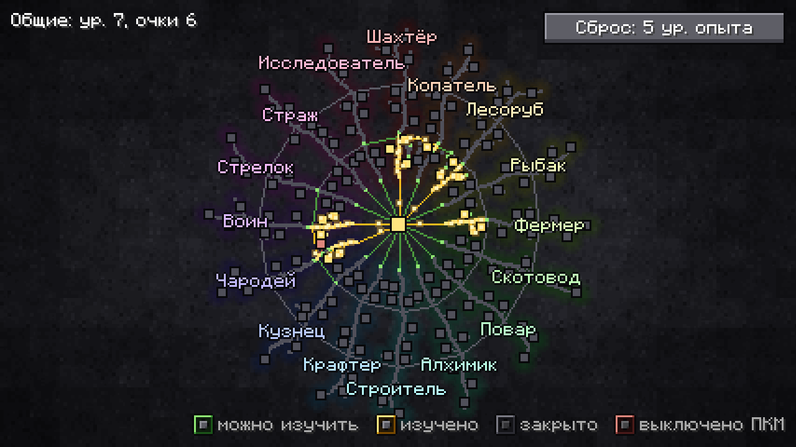
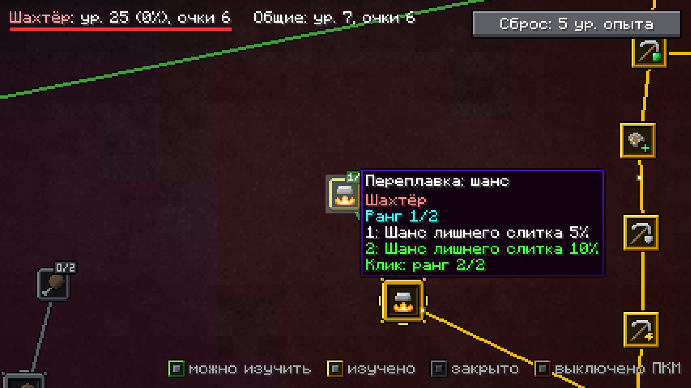
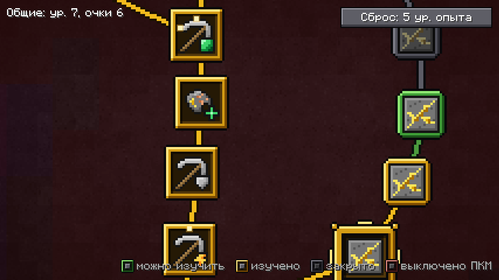
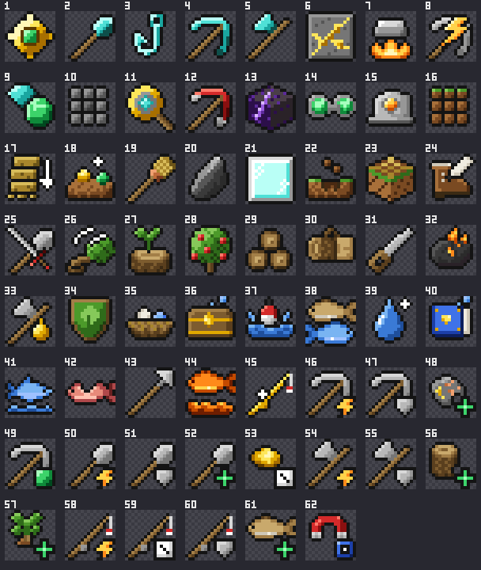

<div align="center">

# Path-of-craft-tree

**Огромное дерево пассивных умений для Minecraft на [Horizon](https://github.com/horizon-rust/horizon).**
Копайте, рубите, готовьте, сражайтесь: каждое занятие качает свою профессию, а уровни приносят очки для дерева на 995 узлов.




</div>

## Что это

Вы получаете опыт профессии за то, чем занимаетесь: кирка качает Шахтёра, удочка Рыбака, лук Стрелка. Уровень профессии понемногу усиливает вас в этом деле и приносит очко, которое тратится в её ветви дерева. Часть опыта идёт ещё и в общую шкалу, а её очки можно потратить в любой ветви, например чтобы подтянуть отстающую.

- **16 профессий в 4 секторах**, 75 уровней у каждой.
- **995 узлов**: малые прибавки, большие умения и их усилители. 83 узла имеют по два ранга.
- **285 эффектов**, каждый проверен в игре: копание площадью, падение дерева целиком, жила руды, автоплавка, карманный верстак, возвращение домой, рудный нюх и многое другое.
- **Честный опыт.** Поставленный блок не даёт опыта, когда его ломаешь. Мобы из спавнера дают четверть. В творческом режиме и за команды опыта нет.
- **Машины работают на владельца.** Механизмы других модов приносят своему владельцу половину опыта за ту же работу ([как подключить свой мод](docs/machine-reports.md)).
- **Сброс дерева** стоит 5 уровней обычного опыта Minecraft.
- **Баланс живёт в данных.** Опыт за действия, кривая уровней и все узлы лежат в `data/tree.json`.

Справочник по всем профессиям с живым деревом, которое можно покрутить и поизучать: [docs/showcase/index.html](docs/showcase/index.html). Он открывается прямо с диска. Данные для него собирает `node design/tools/showcase-data.mjs`.

<table>
<tr>
<td width="50%"></td>
<td width="50%"></td>
</tr>
<tr>
<td align="center">Подсказка: что даёт каждый ранг</td>
<td align="center">У каждого узла своя иконка 16×16</td>
</tr>
</table>

## Профессии

| Сектор | Профессии |
| --- | --- |
| ⛏️ Добыча | **Шахтёр** (кирка), **Копатель** (лопата), **Лесоруб** (топор), **Рыбак** |
| 🌾 Хозяйство | **Фермер**, **Скотовод**, **Повар**, **Алхимик** |
| 🔨 Ремесло | **Строитель**, **Крафтер**, **Кузнец**, **Чародей** |
| 🗺️ Странствия | **Воин**, **Стрелок**, **Страж**, **Исследователь** |

<p align="center"><br><sub>Иконки сектора «Добыча» в стиле ванильного Minecraft</sub></p>

Смежные действия кормят две ветви. Например, руда, которая сразу падает слитком, качает Шахтёра и на 80% Кузнеца. Подробно о каждой профессии, узлах и источниках опыта — в [дизайн-документе](docs/design.md).

## Управление

| Что | Как |
| --- | --- |
| Открыть дерево | **K** или команда `/tree` |
| Изучить узел или следующий ранг | левая кнопка мыши |
| Выключить большой узел (очко не возвращается) | правая кнопка мыши |
| Приблизить, сдвинуть | колесо мыши, перетаскивание |
| Рудный нюх · Картограф · Чутьё сокровищ | **V** · **J** · **N** |
| Возвращение домой · Карманный верстак · Точильщик | **H** · **Y** · **U** |

Клавиши умений работают, когда узел изучен. Остальные приёмы (Линия, Заливка, Замена, Чертёж, Засыпка) описаны в [разделе 9 дизайн-документа](docs/design.md#управление).

## Установка

Нужны [лаунчер Horizon](https://github.com/horizon-rust/horizon) и лицензионный аккаунт Minecraft: Java Edition.

> [!WARNING]
> Нативные моды Horizon компилируются прямо в игру и работают с вашими правами, без песочницы. Перед установкой прочитайте код. Лаунчер попросит подтвердить, что вы доверяете моду.

Мод состоит из двух половин в одном наборе: клиент рисует дерево, сервер считает опыт и эффекты. Поэтому он нужен и в игре, и на сервере.

### Одиночная игра и игра по сети с хостом

**В окне лаунчера:** Mods → **Add from GitHub** → вставьте `https://github.com/Betreazen/path-of-craft-tree` → **Build**.

**Из командной строки:**

```powershell
horizon-launcher mods add-github https://github.com/Betreazen/path-of-craft-tree --trust-native-code
horizon-launcher native-build --trust-native-code
```

Первая сборка скачивает Rust и занимает 20–30 минут, следующие быстрее. Мод собирается на коммите Horizon, который в нём закреплён (`[compatibility] horizon_revision` в `mixins/path_of_craft_tree/horizon-mixin.toml`). Если другие ваши нативные моды закреплены на другом коммите, лаунчер предложит **Build anyway**.

Обновить мод: `horizon-launcher mods update-github --trust-native-code`, затем снова `native-build`.

### Выделенный сервер

Сервер запускает отдельный собранный движок:

```powershell
git clone https://github.com/Betreazen/path-of-craft-tree
horizon-launcher native-build path-of-craft-tree/mixins/path_of_craft_tree `
    --server-output C:\horizon-engines\pct-0.3.0 --version <версия Horizon> --trust-native-code
horizon-server --dir <папка сервера> config set engine.path=C:\horizon-engines\pct-0.3.0\horizon-engine.exe
horizon-server --dir <папка сервера> restart
```

Папка `--server-output` не должна существовать заранее. Чтобы собрать сервер с несколькими модами, положите их папки рядом и передайте `native-build` общую папку. Подробнее — в [документации Horizon о нативных модах](https://github.com/horizon-rust/horizon/blob/main/docs/native-mods.md#standalone-server-export).

Игрокам этого сервера нужен мод той же версии в своей игре. Клиент с другой версией протокола мода сервер отключает.

### Где лежат данные

| Что | Где |
| --- | --- |
| Профиль игрока: опыт и изученные узлы | `<мир>/path_of_craft_tree/<uuid>.json` |
| Отметки поставленных блоков | `<мир>/path_of_craft_tree/placed/` |
| Посещённые чанки для Исследователя | `<мир>/path_of_craft_tree/chunks/` |

Профили пишутся через временный файл. Повреждённый профиль не затирается, а откладывается рядом с расширением `.bad`.

## Для авторов модов

Механизмы вашего мода могут приносить опыт своему владельцу. Достаточно выполнять консольную команду `pct-machine` из кода сервера. Без Path-of-craft-tree она тихо ничего не делает, так что при сборке моды друг от друга не зависят. Форматы отчётов, правила и проверка из консоли описаны в [docs/machine-reports.md](docs/machine-reports.md).

## Разработка

```text
mixins/path_of_craft_tree/   мод: horizon-mixin.toml, модули и хелперы, data/ (дерево, атлас иконок)
lib.rs, benches/             обвязка: тесты и бенчмарки кода, не зависящего от игры
examples/gen_tree.rs         генератор data/tree.json: раскладка и все узлы
examples/preview/            HTML-превью дерева
design/                      иконки (design/icons/*.json, правила в STYLE.md) и инструменты на Node
docs/                        дизайн, контракт для машин, производительность
```

`dev.ps1` собирает и проверяет мод на Windows:

| Команда | Что делает |
| --- | --- |
| `.\dev.ps1 test` | тесты правил, несколько секунд, без сборки игры |
| `.\dev.ps1 tree` | пересобрать `data/tree.json` генератором |
| `.\dev.ps1 data` | скопировать дерево на dev-сервер, он перечитает его без пересборки |
| `.\dev.ps1 server`, `client`, `both` | собрать половины мода |

Флаги: `-BuildProfile dev|performance|release` выбирает профиль сборки, `-Perf` включает счётчики времени горячих путей. Счётчики пишутся в журнал раз в 30 секунд.

```powershell
cargo test                                  # 136 тестов
cargo bench --bench rules                   # бенчмарки criterion на профиле «ветерана»
cargo clippy --all-targets -- -D warnings -A dead_code
```

### Производительность

Первый круг оптимизации, профиль ветерана с изученными 995 узлами, сборка `performance`:

| Путь | Было | Стало |
| --- | --- | --- |
| Кадр окна дерева | 2,4–2,8 мс | 1,5 мс |
| Тик игрока на сервере | 37–42 мкс | 14–17 мкс |
| Начисление опыта | 139–169 мкс | 28 мкс |
| Сообщение о профиле | 16,3 КБ | 8,3 КБ |

Бюджеты и способ замера описаны в [docs/perf-spec.md](docs/perf-spec.md), гипотезы и замеры — в [docs/perf-log.md](docs/perf-log.md).

## In English

Path-of-craft-tree is a native mod for [Horizon](https://github.com/horizon-rust/horizon), the Rust reimplementation of Minecraft 26.3. Sixteen professions earn experience from what you actually do (mining, farming, crafting, fighting…), and their levels pay points into a 995-node passive tree with 285 effects. The in-game text is in Russian for now. Install it from the launcher with **Mods → Add from GitHub** and this repository's link, or follow the commands in the «Установка» section above. Native mods run unsandboxed with your rights, so read the source first.

## Лицензия

[MIT](LICENSE). Мод не связан с Mojang, Microsoft и проектом Horizon и не одобрен ими. Для игры нужен лицензионный Minecraft: Java Edition.
